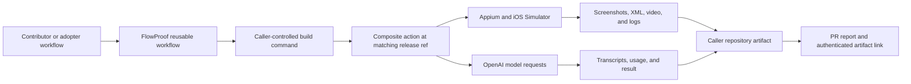

# Prepare FlowProof for an open-source release

## Overview

Make FlowProof a legally open-source, security-reviewed, publicly usable GitHub Action and reusable workflow. Prepare and verify everything while the repository is private, then make the visibility change only after the owner approves the final irreversible disclosure checklist.

The initial distribution remains GitHub-native:

- Public composite action at `gokhanamal/flowproof@<release>`.
- Public reusable workflow at `gokhanamal/flowproof/.github/workflows/ios-e2e.yml@<release>`.
- No npm publication in this launch. Keep `"private": true` as an accidental-publish guard.
- GitHub Marketplace submission, hosted documentation, Discussions, and a bundled executable are follow-up work.

## Why this is needed

The repository is technically healthy but not ready for public redistribution:

- GitHub reports it as private, with no detected license or release tags.
- `package.json:4-6` marks the package private and `UNLICENSED`.
- `README.md:13` and `README.md:214-216` describe proprietary/private use.
- The README advertises `v0.1.0`, but no such tag exists.
- The reusable workflow originally resolved its secret-bearing composite action from the mutable, not-yet-published `v0.1.0` tag instead of audited immutable code.
- Visual assertions are intentionally excluded from `v0.1.0`; screenshots remain evidence artifacts and are not sent to the model.
- The project records and uploads screenshots, accessibility XML, Appium logs, transcripts, and a screen recording. The existing warning at `README.md:154-172` is useful but does not fully describe data egress, public-repository artifact exposure, tracing, deletion, or incident handling.
- Contributor, support, security disclosure, conduct, ownership, and release policies are absent.
- Fourteen existing GitHub workflow runs will have publicly visible history/logs after the visibility change and need explicit review.

Baseline evidence on 2026-07-19:

- `npm run validate` passed type checking and 24/24 tests.
- `actionlint` passed.
- `npm audit --audit-level=high` reported zero known vulnerabilities.
- A basic credential-pattern scan found no matches in the single-commit Git history. This is not a substitute for a dedicated secret scanner.
- Direct dependencies are permissively licensed locally. The transitive lockfile still requires formal policy review, including LGPL, Creative Commons, alternative-license, and missing-metadata entries.

## Target state

A new user can discover the public repository, understand what data and money are at risk, pin an immutable release, run a documented iOS journey, and retrieve an accurate result. An external contributor can fork the project and run all default checks without secrets or Xcode. A maintainer can triage issues, receive private vulnerability reports, and publish or deprecate a release through a documented process.

Public launch is complete only when the repository is open source, not merely source-visible. The root license, package metadata, documentation, and contribution terms must grant consistent rights.

## Decision gates

Resolve and record these before implementation begins:

1. **Ownership and authority**
   - Confirm the copyright holder and that no employer, client, contributor, or third party owns or restricts any committed code, examples, names, or assets.
   - Confirm the existing commit author name/email are acceptable for permanent public display.
   - Confirm `gokhanamal/flowproof` is the durable owner/name. GitHub Action references may break after a later owner or repository rename.

2. **License**
   - Select an OSI-approved license and use its unmodified canonical text.
   - Recommended default for review: Apache-2.0 for its explicit patent grant. MIT is the simpler permissive alternative. Final selection belongs to the owner, with legal advice if ownership or patent concerns exist.
   - Decide whether a `NOTICE` or `THIRD_PARTY_NOTICES` file is required after the dependency/provenance audit.

3. **Inbound contributions**
   - Recommended initial policy: contributions are accepted under the project license without a CLA, stated plainly in `CONTRIBUTING.md`.
   - If provenance requirements are stronger, choose DCO sign-off or a CLA before accepting the first external contribution.

4. **Supported public contract**
   - Define which parts follow SemVer: `action.yml` inputs/outputs, reusable-workflow inputs/secrets/permissions, flow YAML schema, artifact/report formats, supported Node/Appium/Xcode/iOS ranges, and model configuration behavior.
   - Name the supported release line, deprecation window, maintainer, security contact, and best-effort support expectations. Do not imply an SLA unless one will be staffed.

5. **Visual assertions**
   - Exclude visual assertions from `v0.1.0`. Any future screenshot egress requires an explicit design, privacy update, tests, and release note.

6. **Public automation trust model**
   - Decide whether secret-backed same-repository PR runs require a protected GitHub environment and maintainer approval.
   - Fork PRs must run only secretless validation. Do not use `pull_request_target` to check out or execute contributor code.

## Stakeholders and required journeys

### Evaluator

- Understands prerequisites, platform limitations, model/API cost, network access, privacy boundaries, and project maturity from the first README screen.
- Can inspect a safe example flow and representative report without receiving access to private customer/app data.

### Adopter using the reusable workflow

- Pins an exact release tag or full commit SHA.
- Configures the API key, build command, app path, flow, device, model, and artifact retention without undocumented steps.
- Receives an accurate PR result, workflow link, artifact expiry, tested commit, and resolved simulator environment.

### Advanced adopter using the composite action

- Manages simulator lifecycle independently and invokes the exact same release contract documented for the reusable workflow.

### External contributor

- Forks and runs `npm ci`, `npm run validate`, and workflow linting without secrets or macOS-only infrastructure.
- Understands coding conventions, testing expectations, contribution licensing, review, conduct, and how maintainers run privileged E2E checks.

### Maintainer and security reporter

- Maintainer can triage, release, roll back/deprecate, and respond to dependency or security alerts from written checklists.
- Reporter has a private disclosure path and supported-version statement, rather than opening a public vulnerability issue.

## Implementation plan

### Phase 0: Freeze the release candidate and inventory everything private

- [x] Resolve the current dirty worktree deliberately. Review each modified/untracked file and decide whether it belongs in `v0.1.0`; do not discard unrelated user work.
- [x] Review `docs/`, `tasks/`, examples, fixtures, source comments, error strings, URLs, and generated content for internal notes, personal/customer data, proprietary material, or misleading claims.
- [ ] Inventory all branches, tags, GitHub issues/PRs, private forks, releases, Actions caches, and existing workflow runs/artifacts, not only the checked-out `main` branch.
- [ ] Review all fourteen existing workflow-run logs and artifacts before visibility changes. Delete sensitive runs/artifacts while private if needed and record why.
- [ ] Run a dedicated secret scanner such as Gitleaks or TruffleHog across all refs and unreachable/reviewable history supported by the tool. Never paste discovered values into an issue or plan.
- [ ] If a credential is found, revoke/rotate it first. Then decide whether history rewriting is necessary; coordinate any open PRs/forks and verify from a fresh clone.
- [ ] Confirm commit metadata, repository name, examples, brand, and code provenance are intentionally public.
- [x] Expand `.gitignore` for local environment/credential/key files and build/editor outputs, with explicit allow rules for safe templates such as `.env.example` if one is added.

Deliverable: a signed-off disclosure inventory with zero unresolved secret, personal-data, IP, or artifact-history blockers.

### Phase 1: Establish the legal and dependency baseline

- [x] Add the selected canonical `LICENSE` text and copyright notice.
- [x] Change `package.json:6` from `UNLICENSED` to the matching SPDX identifier while retaining `package.json:4` `private: true`.
- [x] Add package metadata useful to readers and tools: repository, homepage, bugs, keywords, and author/maintainer fields. Do not add npm entry points or publishing configuration.
- [x] Replace proprietary/private wording in the README with the public installation path and license summary.
- [ ] Generate and review a dependency license inventory for production and development dependencies. Resolve missing license metadata and verify obligations for alternative-license, Creative Commons, and LGPL transitive entries.
- [ ] Add `THIRD_PARTY_NOTICES` only when the reviewed licenses or copied material require it; avoid a generated notice dump with no policy owner.
- [x] Document the inbound contribution license policy in `CONTRIBUTING.md`.

Deliverable: GitHub detects the intended OSI license, `package.json` and README agree, and the dependency review has no unresolved distribution blocker.

### Phase 2: Define governance and the contributor experience

- [x] Add `CONTRIBUTING.md` with prerequisites, setup, architecture orientation, style, `npm run validate`, `actionlint`, test expectations, commit/PR guidance, contribution licensing, and the fork-safe CI model.
- [x] Add a recognized `CODE_OF_CONDUCT.md` with a private enforcement route.
- [x] Add `SECURITY.md` with supported versions, response expectations, private disclosure instructions, and an explicit warning not to report vulnerabilities in public issues.
- [x] Add `SUPPORT.md` or an equivalent README section distinguishing bugs, questions, security reports, and best-effort support.
- [x] Add issue forms for bug reports and feature requests, a pull-request template, and a configuration that routes security reports away from public issues.
- [x] Add `.github/CODEOWNERS` for action metadata, workflows, dependency manifests/lockfiles, security files, and release automation. Use it for routing initially; do not require self-approval if there is only one maintainer.
- [x] Add a concise maintainer/release policy and `CHANGELOG.md`. A separate governance document is optional until multiple maintainers share authority.

Deliverable: a stranger can contribute or report a vulnerability without private instructions.

### Phase 3: Make privacy, cost, and trust boundaries explicit and enforceable

- [x] Create a data-flow document or README table covering each data class:
  - Flow name, description, instructions, accessibility nodes, tool/model turns.
  - Optional screenshot sent for visual assertions, if included.
  - Local screenshots, raw accessibility XML, screen recording, Appium log, reports, and transcripts.
  - Recipient/location, trigger, redaction, retention, deletion, and who can access it in private versus public caller repositories.
- [x] Document that visual assertions are excluded and screenshots are not sent to the model in `v0.1.0`.
- [x] Document tracing behavior. The composite action disables Agents tracing; local CLI behavior is documented explicitly.
- [x] Document that accessibility text, flow content, and rendered screen content may include personal or secret data even when transcript tool arguments are redacted.
- [x] Expose artifact retention through the reusable workflow, choose a conservative default, state artifact visibility plainly, and document deletion/incident steps.
- [x] Prohibit production credentials/data in flows and document model availability, quota/rate-limit behavior, budget alerts, and concurrency/cost controls.
- [x] Publish a safe workflow matrix:
  - Fork PR: secretless CI only.
  - Trusted branch/manual run: secret-backed iOS E2E.
  - Same-repository PR: only under the selected maintainer/environment approval policy.
- [x] Keep default `GITHUB_TOKEN` permissions read-only. Move `pull-requests: write` to a separate report job that receives no API secret or untrusted checkout.
- [x] Document why caller-provided `build_command` is arbitrary code and must execute only from a reviewed ref before a secret is introduced.

Deliverable: documentation and workflows express the same threat model, and an untrusted contributor cannot trigger secret-backed or privileged code execution.

### Phase 4: Harden the public distribution and release contract

- [x] Replace the reusable workflow's mutable internal action ref with the audited licensed-action commit `99db59105f873e02f6cd48083e93c97027738ab6`.
- [x] Keep full-length commit-SHA pins for third-party Actions and add a test or policy check that rejects mutable third-party refs.
- [x] Keep npm publishing out of scope and retain `private: true`. Document runtime registry/network requirements and lockfile behavior.
- [x] Add `actionlint` to CI rather than documenting it only as a local command.
- [x] Add dependency review for pull requests and a reproducible dependency-license policy/report. Preserve weekly npm and Actions Dependabot coverage.
- [ ] Enable or configure CodeQL/default code scanning for TypeScript and Actions workflows, secret scanning, push protection, Dependabot alerts, and security updates when the public feature set becomes available.
- [ ] Test contract errors for missing API key, app/flow path, unsupported model, Appium startup, simulator/runtime selection, upload failure, and missing PR-write permission.
- [x] Record the resolved device/runtime when fallback occurs so the tested environment is explicit.
- [x] Scope reports to an exact commit and run attempt, report cancellation/failure states, and state artifact expiry so an older result cannot imply generic current status.
- [x] Add a release checklist covering version/contract changes, changelog, exact ref consistency, dependency and secret scans, clean-clone checks, canary result, tag creation, release notes, rollback/deprecation, and optional moving `v0` alias.
- [x] Document exact SemVer tag and full-SHA consumption. If a moving `v0` tag is offered, label it as a convenience pointer and maintain it only after the immutable release passes canary verification.

Deliverable: every advertised consumption path resolves immutable, matching code and is protected by fork-safe validation.

### Phase 5: Verify a release candidate while still private

- [ ] Start from a fresh clone or clean worktree, run `npm ci`, `npm run validate`, `actionlint`, the secret scan, dependency audit, and license policy.
- [ ] Verify a clean Git status after generated checks; no build output, local cache, artifact, or credential file may be required from an untracked path.
- [ ] Use a separate private fixture/canary repository with private-Action access to exercise the exact candidate ref on GitHub-hosted macOS:
  1. Build a simulator app.
  2. Create/boot the selected simulator.
  3. Run the reusable workflow through navigation and deterministic evidence.
  4. Upload the expected evidence.
  5. Publish an accurate PR report.
- [ ] Smoke-test the direct composite-action path separately if it remains advertised.
- [ ] Exercise negative paths: deterministic failure, missing input/secret, model/quota error, build failure, cancellation/supersession, artifact-upload failure, and unavailable simulator/device.
- [ ] Inspect the sample artifact manually and with secret detection. Confirm it contains no API key, entered secret, provider internals, hidden reasoning, unintended personal data, or misleading retention claims.
- [ ] Have a fresh evaluator and contributor follow the README and CONTRIBUTING guide without private context; convert every undocumented step into documentation or automation.

Deliverable: a reviewed release-candidate commit and recorded canary evidence, with no unresolved launch blocker.

### Phase 6: Perform the public cutover and publish `v0.1.0`

This phase requires explicit owner approval immediately before changing visibility. Code, history, prior workflow logs, and activity become public and forkable; later making the repository private cannot retract copies.

- [ ] Capture current repository settings, Actions permissions, allowed Actions policy, environments, secrets, rulesets/protections, and security settings for comparison.
- [ ] Complete a final go/no-go review of ownership, license, full-history scan, workflow logs/artifacts, release candidate, privacy copy, community files, and canary evidence.
- [ ] Change repository visibility from private to public.
- [ ] Immediately verify or recreate `main` branch protection, and re-enable any push rulesets that GitHub disabled during the private-to-public change:
  - Pull requests required.
  - Required `CI`/lint/security checks.
  - Conversation resolution required.
  - Force pushes and branch deletion disabled.
  - Code-owner approval enabled only when the maintainer topology can satisfy it.
- [ ] Enable private vulnerability reporting and verify dependency graph/review, Dependabot alerts/updates, code scanning, secret scanning, and push protection.
- [ ] Set the repository description, topics, website if any, social preview, issue links, and community profile. Keep Discussions and Wiki disabled until someone owns them.
- [ ] Enable release immutability before creating the first release if available for this repository.
- [ ] Create the reviewed immutable `v0.1.0` tag/release with changelog, compatibility, data/cost warnings, and pinning instructions. Do not retarget the versioned release tag.
- [ ] From a separate public fixture repository, run both advertised paths against the exact tag and a documented full SHA. Verify build, simulator, journey, evidence, upload, and reporting.
- [ ] Add/update the optional moving `v0` tag only after the exact release succeeds.
- [ ] Verify every README link/ref from a logged-out or unrelated-user perspective and confirm the GitHub community profile detects the intended files.
- [ ] Announce only after the public canary and settings audit pass.

Deliverable: a public, protected repository and verified `v0.1.0` release that new users can consume without mutable refs.

### Phase 7: Operate the project after launch

- [ ] Triage the first public dependency, code-scanning, secret-scanning, and community-profile findings; distinguish inherited advisories from launch regressions.
- [ ] Monitor the public canary, issue quality, setup failures, model cost, artifact incidents, and maintainer load for the first release cycle.
- [ ] Review permissions, environments, dependency pins, vulnerability reporting, and release access periodically.
- [ ] Record breaking contract changes in the changelog and publish a deprecation notice before retiring a supported release line.
- [ ] Reassess Marketplace listing, bundled action distribution, npm CLI/package, provenance/SBOM attestations, hosted docs, and Discussions only after the GitHub-native path is stable.

## System-wide impact

### Interaction graph

The release must preserve this boundary: FlowProof's public repository supplies code, while the caller owns its API secret, application build, captured evidence, artifact visibility, cost, and approval policy.

### Failure propagation

- Build, path, simulator, Appium, model/quota, evidence, artifact upload, and PR-comment failures must remain distinguishable.
- Artifact/comment cleanup runs with `always()`, but reporting failures must not overwrite or obscure the primary journey result.
- A cancelled or superseded run must not leave an older passing comment that appears current.
- Registry/network failure is currently a runtime failure because the composite action installs npm/Appium dependencies on each run.

### State and privacy risks

- Partial runs may still leave screenshots, XML, logs, video, or a PR comment.
- Artifact names can collide across concurrent runs unless caller naming/concurrency prevents it.
- Transcript redaction does not sanitize text rendered later in screenshots/XML/video or written to Appium logs.
- Optional visual assertions change screenshot egress from local/GitHub-only storage to an OpenAI request and require explicit disclosure.

### Public API parity

Any contract change must be reflected consistently in:

- `action.yml`
- `.github/workflows/ios-e2e.yml`
- `README.md`
- `examples/*.flow.yaml`
- Flow schema and tests in `src/flow.ts` / `test/flow.test.ts`
- Repository tests in `test/repository.test.ts`
- Changelog and release notes

## Acceptance criteria

### Legal and disclosure

- [ ] Root `LICENSE` is OSI-approved and detected by GitHub.
- [x] README, package SPDX metadata, copyright, and contribution terms agree.
- [ ] Owner/IP, dependency-license, copied-material, commit-metadata, full-history secret, and prior workflow-log/artifact reviews have zero unresolved blockers.
- [x] No proprietary/private wording or undisclosed screenshot/accessibility/model data path remains.

### Quality and security

- [ ] Fresh clone passes `npm ci`, `npm run validate`, `actionlint`, dependency audit/review, secret scan, and license policy.
- [ ] Required checks protect `main`; force pushes/deletion are disabled.
- [x] Third-party Actions are pinned to reviewed full commit SHAs.
- [ ] Fork PR verification proves that no repository secret, write token, secret-backed E2E job, or privileged untrusted-code path is available.
- [ ] Trusted-run verification proves the selected approval path and least-privilege reporting work.

### Distribution and UX

- [x] No prepared workflow or action path resolves a mutable branch or tag for executable code.
- [ ] Tagged reusable workflow and composite action resolve the same reviewed release.
- [ ] A separate public fixture consumes the exact `v0.1.0` tag and full SHA successfully on GitHub-hosted macOS.
- [ ] Both reusable and direct composite paths are tested if both are advertised.
- [ ] Fresh evaluator/adopter/contributor walkthroughs complete without undocumented steps.
- [ ] Every input, output, permission, secret, prerequisite, supported version, network dependency, cost boundary, artifact, and common error is documented.

### Reporting and operations

- [ ] Pass, deterministic failure, build failure, cancellation/supersession, model error, upload failure, and comment failure cannot leave a misleading current green report.
- [ ] Reports identify tested commit/run, resolved simulator environment, artifact expiry, and primary failure stage.
- [x] `SECURITY.md`, `CONTRIBUTING.md`, `CODE_OF_CONDUCT.md`, support/version policy, issue forms, PR template, CODEOWNERS, changelog, and release checklist exist before visibility changes.
- [ ] Private vulnerability reporting and the selected GitHub security features are enabled and owned.
- [x] A rollback/deprecation plan exists; it does not rely on making already-forked code private again.

## Risks and mitigations

| Risk | Likelihood / impact | Mitigation |
| --- | --- | --- |
| Secret, customer data, or proprietary code exists outside current `main` | Low-to-medium / critical | Scan all refs and review PRs, forks, runs, artifacts, and caches while private; rotate first, rewrite only when necessary. |
| License or contribution rights are invalid | Medium / critical | Confirm ownership and use canonical OSI text; complete dependency/provenance review before applying the license. |
| Versioned workflow executes changed code through a mutable internal ref | Addressed / high | Pin the licensed action commit by full SHA and verify the release tag externally. |
| Public PR exfiltrates API key or abuses model budget | Medium / critical | Secretless fork CI, approval-gated trusted E2E, read-only defaults, no privileged execution of untrusted code, cost/concurrency controls. |
| Evidence exposes rendered credentials or personal data | Medium / high | Prohibit production data, disclose every artifact/data path, short caller-controlled retention, deletion guidance, canary artifact inspection. |
| Mutable dependencies or registry outage break consumers | Medium / medium-high | Lockfile, SHA-pinned Actions, dependency review, release canary; evaluate bundled distribution later. |
| Hosted macOS/Xcode/device/model drift breaks setup | Medium / medium | State support matrix, record resolved environment, provide actionable failures, maintain scheduled/manual canary. |
| Solo-maintainer governance blocks or overwhelms work | Medium / medium | Best-effort support statement, narrow issue templates, CODEOWNERS routing without impossible self-approval, explicit release/security owner. |
| Visibility rollback is mistaken for confidentiality recovery | Low / critical | Treat cutover as irreversible disclosure; archive/deprecate for rollback and assume forks/copies persist. |

## Effort and ownership

- **Owner/legal decisions:** license, copyright, contribution terms, permanent repository identity, support promise.
- **Engineering:** privacy/trust hardening, immutable ref strategy, CI/security checks, failure reporting, canary fixture.
- **Documentation/community:** README, data flow, contributing, security, support, conduct, templates, changelog, release checklist.
- **GitHub administration:** visibility, rulesets, Actions policies, environments, vulnerability reporting, security features, release immutability, tag/release.

Expected engineering effort is several focused days after decisions are made. Ownership/licensing review and a representative iOS canary can extend the calendar time; they are release gates, not optional polish.

## Sources and references

### Internal

- Distribution/package state: `package.json:1-29`, `action.yml:1-119`
- Reusable workflow and trust boundary: `.github/workflows/ios-e2e.yml:1-140`
- Current CI and SHA pins: `.github/workflows/ci.yml:1-36`
- Existing setup, artifact, cost, privacy, and license copy: `README.md:9-216`
- Data collection/model boundary: `src/agent.ts:47-64`, `src/agent.ts:178-248`
- Local evidence and recording: `src/evidence-store.ts:23-32`, `src/cli.ts:19-44`
- Transcript redaction: `src/transcript.ts:4-60`
- Repository contract tests: `test/repository.test.ts:1-41`

### External authoritative guidance

- [GitHub: Setting repository visibility](https://docs.github.com/en/repositories/managing-your-repositorys-settings-and-features/managing-repository-settings/setting-repository-visibility)
- [GitHub: What happens to forks when visibility changes](https://docs.github.com/en/pull-requests/collaborating-with-pull-requests/working-with-forks/what-happens-to-forks-when-a-repository-is-deleted-or-changes-visibility)
- [GitHub: Removing sensitive data](https://docs.github.com/en/authentication/keeping-your-account-and-data-secure/removing-sensitive-data-from-a-repository)
- [Open Source Initiative: Approved licenses](https://opensource.org/licenses)
- [SPDX license list](https://spdx.org/licenses/)
- [npm: `package.json` fields and `private`](https://docs.npmjs.com/files/package.json/)
- [GitHub: Default community health files](https://docs.github.com/en/communities/setting-up-your-project-for-healthy-contributions/creating-a-default-community-health-file)
- [GitHub: Coordinated vulnerability disclosure](https://docs.github.com/en/code-security/concepts/vulnerability-reporting-and-management/coordinated-disclosure)
- [GitHub Actions: Secure use reference](https://docs.github.com/en/actions/reference/security/secure-use)
- [GitHub Actions: Secure `pull_request_target` use](https://docs.github.com/en/actions/reference/security/securely-using-pull_request_target)
- [GitHub Actions: Approving runs from forks](https://docs.github.com/en/actions/how-tos/manage-workflow-runs/approve-runs-from-forks)
- [GitHub: Dependency review](https://docs.github.com/en/code-security/concepts/supply-chain-security/dependency-review)
- [GitHub: Rulesets](https://docs.github.com/en/repositories/configuring-branches-and-merges-in-your-repository/managing-rulesets/about-rulesets)
- [GitHub: CODEOWNERS](https://docs.github.com/en/repositories/managing-your-repositorys-settings-and-features/customizing-your-repository/about-code-owners)
- [GitHub Actions: Immutable releases and tags](https://docs.github.com/en/actions/how-tos/create-and-publish-actions/using-immutable-releases-and-tags-to-manage-your-actions-releases)
- [GitHub Actions: Reusing workflow configurations](https://docs.github.com/en/actions/reference/workflows-and-actions/reusing-workflow-configurations)

## Review summary

- The smallest coherent launch is a public GitHub Action/reusable workflow, not an npm package or Marketplace program.
- The highest-risk work occurs before visibility changes: ownership/license, complete disclosure review, privacy/trust consistency, and immutable version resolution.
- Public visibility is deliberately the penultimate operational step, followed immediately by protection/security setup and an unrelated-user canary before announcement.
- Repository preparation was implemented on `chore-open-source-readiness` in commits `99db591`, `2f28d43`, and `51de00c`.
- A clean `npm ci` installed 530 packages and reported zero vulnerabilities. `npm run validate` passed type checking and all 28 tests; `actionlint`, Markdown-link, issue-template YAML, and diff checks passed.
- Security review findings were resolved with a manual-only default example, immutable licensed action SHA, least-privilege reporting job, and bot-authored comment filtering.
- Remaining owner-operated gates are intentionally unchecked: dedicated full-history/run-artifact secret audit, GitHub visibility/security settings, external canary, and `v0.1.0` release publication.

## Post-Deploy Monitoring & Validation

No deployment occurred during repository preparation. After the eventual public
cutover, monitor the first public CI runs, dependency/security alerts, failed
setup reports, artifact-access incidents, and model spend for one release cycle.

- **Healthy:** required checks pass; the public fixture succeeds by tag and SHA;
  private vulnerability reporting works; no secret-backed fork job runs.
- **Rollback/mitigation trigger:** secret exposure, license/IP blocker, mutable
  executable ref, or misleading green report. Archive or deprecate and issue a
  new release; visibility reversal is not a confidentiality rollback.
- **Owner:** `@gokhanamal`.
